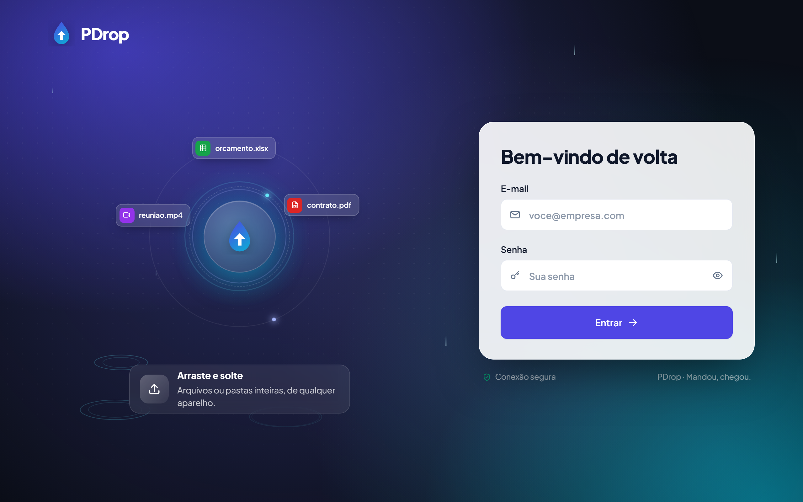
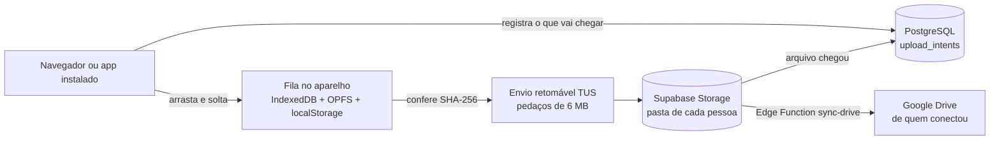
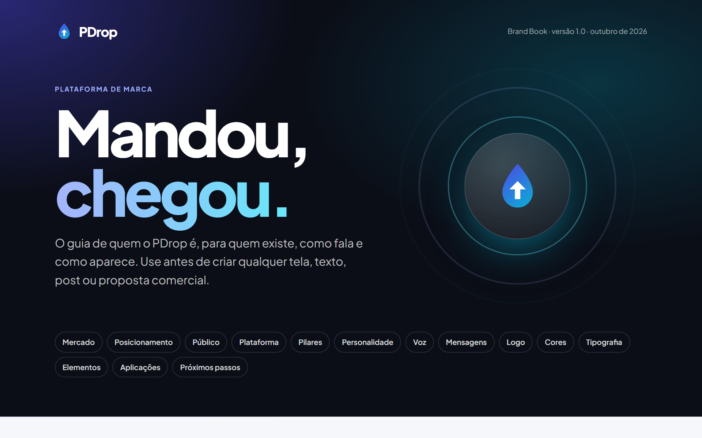
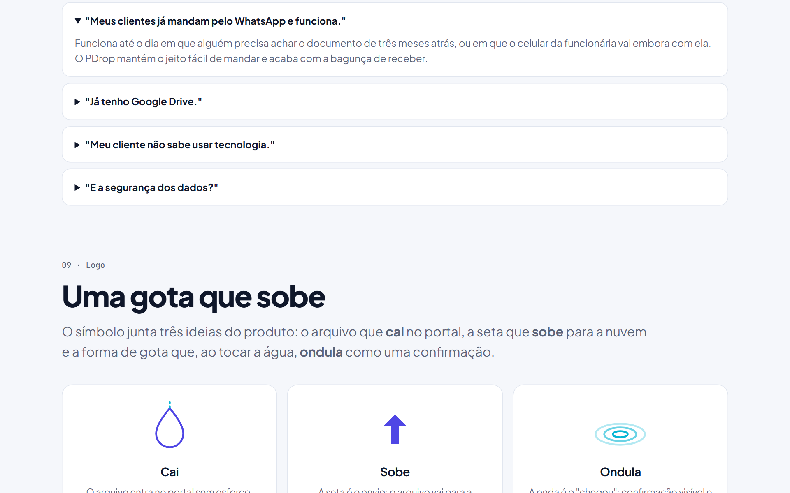
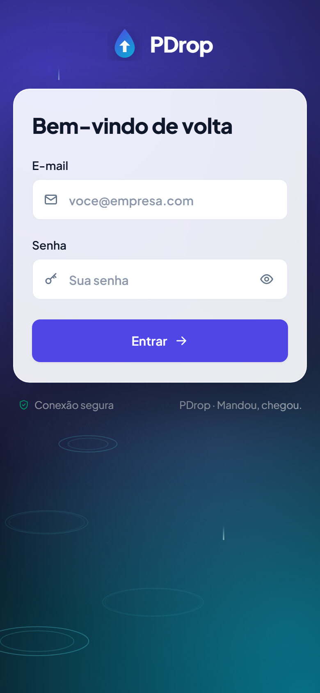

# PDrop: estudo de caso

**O problema:** escritórios de contabilidade, advocacia, engenharia e clínicas recebem documentos dos clientes por WhatsApp, e-mail e pendrive. Arquivo se perde, chega corrompido ou some quando o celular de alguém vai embora. A pergunta que mais se repete é "você recebeu meu arquivo?".

**A solução:** um portal para *receber* arquivos. A pessoa entra, arrasta e solta, e o arquivo chega organizado, conferido e seguro, de qualquer aparelho, até sem internet.

> O código do PDrop é privado porque o produto é comercial. Este repositório mostra a arquitetura, as decisões e a marca. As telas não têm dado de nenhuma pessoa ou empresa.

## O que o PDrop faz

- Login por convite com link (sem cadastro público), três papéis e verificação em duas etapas (TOTP)
- Arrastar e soltar arquivos ou pastas inteiras, com barra de progresso
- Armazenamento no Supabase Storage e cópia opcional no Google Drive de cada pessoa
- Fila de envio que sobrevive a queda de internet, fechamento do app e desligamento do computador
- Verificação do formato real do arquivo pelo conteúdo, não pela extensão
- Chat em tempo real com anexos
- Links de compartilhamento com validade de 1, 7 ou 30 dias
- App instalável (PWA) em Windows, Mac, Android e iPhone

## Arquitetura

| Camada | Tecnologia |
|---|---|
| Front-end | HTML, CSS e JavaScript sem framework; service worker para modo offline e "Compartilhar" do sistema |
| Dados e regras | PostgreSQL no Supabase com Row Level Security por papel; 13 migrations |
| Servidor | 4 Edge Functions: convites, administração de contas, conexão com o Google e cópia para o Drive |
| Envio | Upload retomável (TUS), Web Locks para só uma aba enviar |
| Segurança | MFA (TOTP), captcha no login, links de compartilhamento com validade |

## Decisões e problemas resolvidos

1. [Uma fila de envio que não perde arquivo](casos/01-fila-que-nao-perde-arquivo.md)
2. [Conferir o arquivo pelo conteúdo, não pelo nome](casos/02-formato-pelo-conteudo.md)
3. [Quem vê o quê: regras de acesso no banco](casos/03-regras-de-acesso-no-banco.md)
4. [Produto e marca: "Mandou, chegou."](casos/04-produto-e-marca.md)

## Números

| Item | Valor |
|---|---|
| Commits | 40, entre 29/10 e 05/11/2026 |
| Migrations | 13 |
| Edge Functions | 4 |
| Papéis | 3 (Administrador, Gerente e Comum) |

## Marca

| Capa do brand book | Símbolo |
|---|---|
|  |  |

No celular:

## Autor

Gean Bonni, desenvolvedor Python. [LinkedIn](https://www.linkedin.com/in/geanbonni) · [GitHub](https://github.com/geanprofcd)
