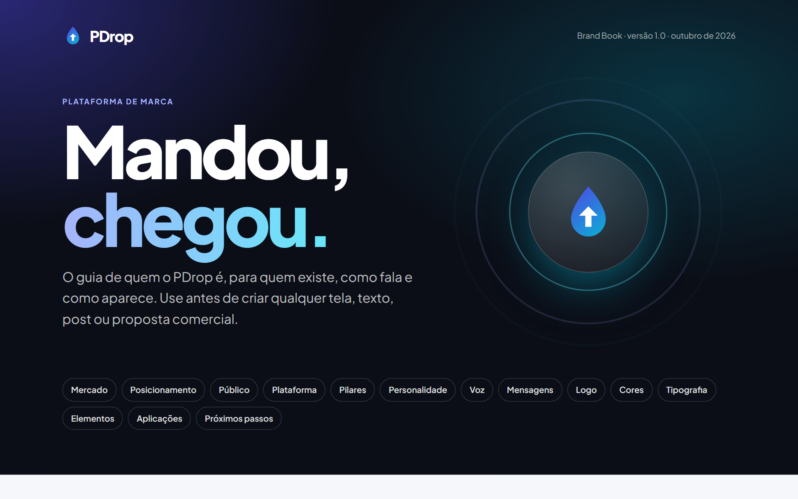

# Produto e marca: "Mandou, chegou."

## A decisão de posicionamento
O mercado fala de *enviar* arquivos. Quem paga, porém, é quem *recebe*: o escritório que precisa do documento do cliente. Por isso o PDrop se posiciona como portal de recebimento, para empresas de serviço de 2 a 50 pessoas.

## Os quatro "chega"
Cada mensagem da marca se apoia num pilar e cita uma prova real do produto:
- **Chega sempre:** fila que funciona sem internet.
- **Chega certo:** formato conferido pelo conteúdo.
- **Chega seguro:** cada um vê só o que é seu.
- **Chega fácil:** qualquer aparelho, sem instalar nada.

## Identidade
- Símbolo: uma gota com uma seta para cima. O arquivo "cai" no portal, "sobe" para a nuvem e, ao chegar, "ondula" como confirmação.
- Palavra da marca no produto: "Chegou ✓", usada sempre que um envio termina.
- Tom de voz: português direto, frases curtas, sem jargão. A tela fala do que acontece com o arquivo ("Sem internet: continua sozinho quando a conexão voltar"), nunca mostra só um código de erro.
- Brand book com mercado, público, personalidade, voz, logo, cores, tipografia e aplicações.

## O que eu levo
Decidir para quem o produto existe antes de desenhar a tela economiza retrabalho. O "Chegou ✓" saiu do posicionamento, não do design.
